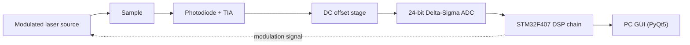

# Digital Lock-in Amplifier for Optical Spectrometry

A project overview of a **software lock-in amplifier running on a single microcontroller**, developed as a graduation project at Eskişehir Technical University (09/2025 - 06/2026) in partnership with SONACL Technology Inc. The work was done by a team of three.

> **Confidentiality note.** The resulting device belongs to SONACL Technology Inc. This repository therefore contains **no source code, schematics, PCB layouts, operating parameters or filter settings**. It describes the architecture, my own contribution and the engineering reasoning only. More detail can be discussed in an interview, within what the partner allows.

## Goal

Spectrometers rely on lock-in amplifiers to pull a weak optical signal out of noise, and commercial systems are expensive and mostly imported. This project replaces the analog lock-in hardware with a software lock-in on a microcontroller, aiming at a low-cost, domestically built measurement platform for a UV-Vis style absorbance spectrometer.

## System Architecture

The microcontroller generates the modulation signal that drives the laser. The light that passes through the sample is detected by a photodiode and a transimpedance amplifier, passes a DC offset stage, and is digitized by a 24-bit delta-sigma ADC.

On the microcontroller, the digitized signal goes through this processing chain:

**high-pass filter → Goertzel → Kalman → EMA → absorbance**

A stability check at the end locks a repeatable final reading, which is sent to a PC GUI.

## My Contribution

- **DSP chain in C.** Wrote the Goertzel, Kalman and exponential moving average stages of the firmware that runs on the STM32F407.
- **Real-time SNR measurement algorithm** to quantify how well the chain suppresses noise while the system runs.
- **Analog front end.** Contributed to the LTspice simulations and the PCB design of the analog front end around the 24-bit ADC.

## Engineering Decisions

- **Goertzel instead of FFT.** Only one frequency matters, and Goertzel computes a single bin in linear time with low memory use, which suits a microcontroller.
- **Blocking SPI instead of DMA.** A DMA-based read was tried first, but its setup time conflicted with the ADC data-ready rate. Switching to blocking reads removed the data loss and made debugging easier.
- **Mode-based stability detection.** Instead of a standard deviation test, the system keeps the most frequently occurring reading, which is robust to noise and slow drift.
- **Four-layer PCB with split analog and digital ground,** so that digital switching noise does not reach the sensitive analog path.
- **Rejected a hardware differential photodiode input.** The photodiode metal housing is tied to its cathode, so connecting it to the amplifier input would act as an antenna for EMI. The topology was dropped on purpose.

## Results and Validation

The system was tested in the laboratory with dye solutions under three optical conditions: no sample, semi-transparent and opaque. The measured signal fell as the sample became denser, in line with the Beer-Lambert law. After a blank calibration, reinserting the same sample gave the same stable absorbance value, and no samples were missed during acquisition at the ADC's full data rate.

## Limitations and Next Steps

The prototype works at a single wavelength, so full spectral scanning is not yet possible, and the GUI link over UART has not been fully tested under measurement conditions. Planned improvements are multi-wavelength operation, phase-independent I/Q demodulation, a true differential detector design and a calibration curve for direct concentration readout.

## Tools

C, STM32CubeIDE, Python/PyQt5, LTspice, PCB CAD

**Hardware:** STM32F407 microcontroller, 24-bit delta-sigma ADC

## Author

Uğur Karadeniz - [GitHub](https://github.com/ugurkaradeniz23)
